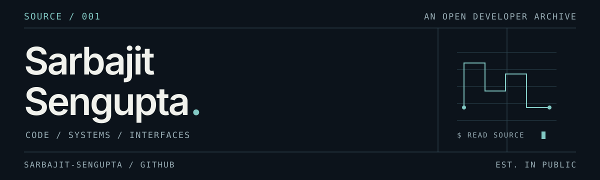
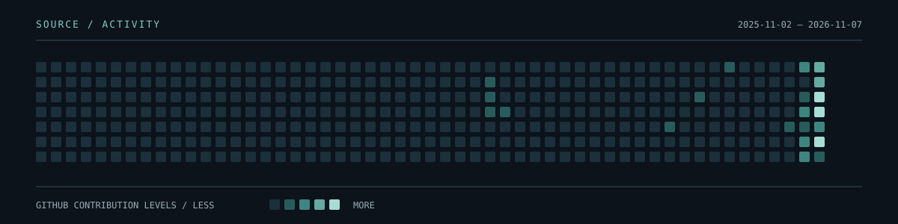

I'm Sarbajit, a computer science student exploring AI/ML, full-stack development and open source. I like examining how software behaves, from cache policies to the details of an interface.

## 01 / Selected projects

**[TraceCache](https://github.com/Sarbajit-Sengupta/tracecache)** · `Python`  
An offline cache-sizing library and CLI. A Fenwick-tree stack-distance profile produces an exact LRU miss curve; FIFO and Belady simulations provide points of comparison for equal-sized objects.

**[CrowdMind](https://github.com/Sarbajit-Sengupta/crowdmind)** · `TypeScript`  
A stadium-operations dashboard project exploring how match risk factors can be brought together in a command-center interface.

## 02 / Contributions, selected

Merged work in projects outside this account:

- **[ArcadeVerse #461](https://github.com/DebasmitaBose0/ArcadeVerse/pull/461)** — Shareable UTF-8 playlist codes, with input validation and storage-failure handling. `MERGED`
- **[CAREERFORGE #256](https://github.com/Pratyush-Panda-2006/CAREERFORGE/pull/256)** — An interactive, responsive order-book depth chart using simulated data. `MERGED`
- **[CAREERFORGE #257](https://github.com/Pratyush-Panda-2006/CAREERFORGE/pull/257)** — Accessible terminal command shortcuts that share the existing command path. `MERGED`

## 03 / Activity

Refreshed daily from GitHub's contribution data when the workflow succeeds. [Explore the contribution record →](https://github.com/Sarbajit-Sengupta)

## 04 / Currently exploring

AI and machine learning · Python · React, Next.js and TypeScript · developer tools · open source

---

[GitHub](https://github.com/Sarbajit-Sengupta) · [Repositories](https://github.com/Sarbajit-Sengupta?tab=repositories)

